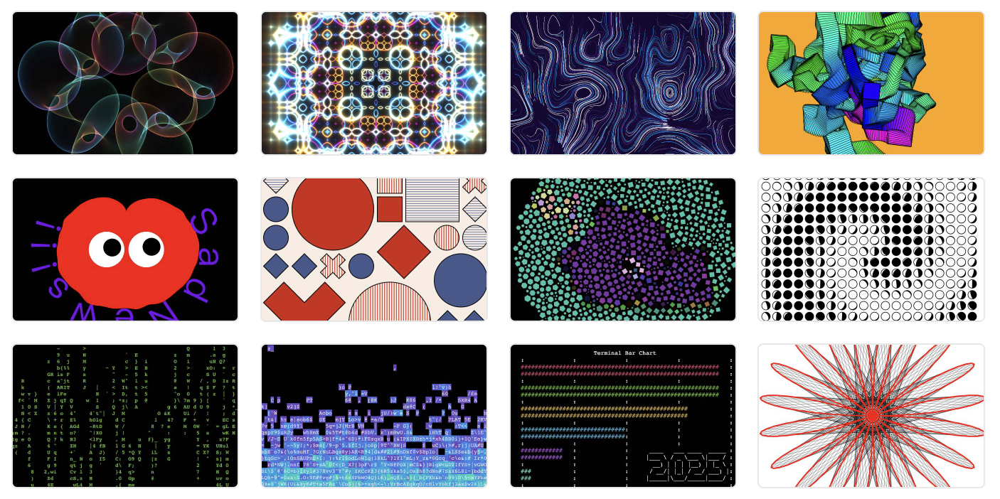

# Charming

> _Think of Charming as Lodash for graphics, or D3 for computational art._

**Charming**, short for _Charming Computing_, is a [free](https://github.com/charming-art/charming/blob/main/License), [open-source](https://github.com/charming-art/charming) data-driven language for creative coding and ASCII art with high performance. It has a declarative, concise, yet expressive API inspired by [G2.js](https://github.com/antvis/G2), [D3.js](https://github.com/d3) and [P5.js](https://p5js.org/).

## Links

- [What is Charming?](https://charmingjs.org/) - A brief introduction to Charming
- [Why Charming?](https://charmingjs.org/why-charming) - The inspiration and motivation behind Charming
- [Get Started](https://charmingjs.org/get-started) - Installation instructions and quick examples
- [Examples](https://charmingjs.org/examples/) - Explore a collection of Charming examples
- [Gallery](https://charmingjs.org/gallery/) - Explore a collection of Charming projects
- [API Index](https://charmingjs.org/api-index) - All the APIs, with links to their docs
- [GitHub](https://github.com/charming-art/charming) - Source code and issues

## Features

Charming is built on the observation that both visualization and generative art are, to some extent, data-driven.

Therefore, it provides a novel [flow-based](https://charmingjs.org/flow) API for processing data, appending and transforming shapes. Charming also supports batch rendering of 2D primitives using a [WebGL renderer](https://charmingjs.org/examples/waltz-of-circles), and defining some [GLSL functions](https://charmingjs.org/webgl#cm-glsl) to offload expensive computations to the GPU. Additionally, a [terminal renderer](https://charmingjs.org/examples/ascii-fire) for ASCII art, embedded in JavaScript, utilizes a software rasterizer written in Rust and compiled to WASM, aiming to achieve high performance. Charming also puts strong emphasis on being extensible, composable and beginner-friendly.

My hope with Charming is that you spend less time wrangling the machinery of programming and more time "using computing to tell stories". Or put more simply: **With Charming, you'll express more, and more easily.**

## License

Charming is released under the [MIT License](https://github.com/charming-art/charming/blob/main/License).
